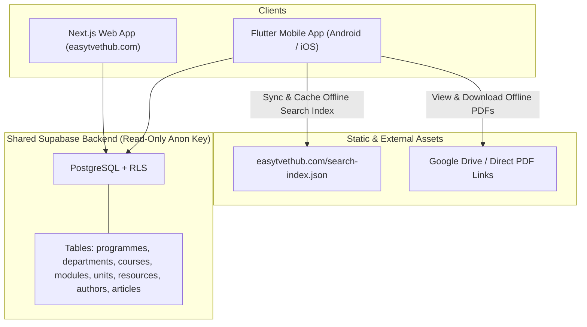

# EasyTVET Hub — Comprehensive Flutter Mobile App Development Guide

This guide provides the complete technical and design blueprint to build a native **Flutter (Android & iOS)** mobile application for **EasyTVET Hub (`easytvethub.com`)** that shares the exact same **Supabase Postgres backend**, **Row-Level Security (RLS)** read policies, **domain logic**, and **visual design system** as the Next.js web application.

> **Scope:** This mobile app is a **student/trainee-focused, read-only companion app** with offline PDF downloads, bookmarks, and synced offline search. Content management and administration remain exclusively on the web `/admin/` panel.

---

## 1. System Architecture & Shared Backend Contract

Both the Next.js web app and the Flutter mobile app connect to the **same Supabase project** using only the public **`anon` key**. No custom backend server, user login, or middleware is required—all public read access is enforced directly by PostgreSQL Row-Level Security (`supabase/schema.sql`).



### Shared Backend Rules (Public Read-Only RLS Parity)
Your Flutter app automatically inherits these exact Postgres RLS policies without needing authentication:
- **Public Read (all rows):** `programmes`, `departments`, `modules`, `resources`, `authors`
- **Public Read (published only):** `courses` (`published = true`), `units` (`published = true`), `articles` (`published = true`)
- **Write Access:** Blocked for anonymous clients (`public.is_admin()` evaluates to `false`). No auth screens or admin code should be shipped in the mobile app.

### Mobile vs. Web Fetching Strategy
The Next.js web app fetches the entire database in 1,000-row batches at *build time* (`lib/data.ts`). On mobile, **do not** download every table on app launch—Kenyan TVET trainees are often on metered mobile data. Instead:
1. Use **on-demand relational Supabase queries** cached in memory with Riverpod.
2. Sync **`https://easytvethub.com/search-index.json`** in the background and cache it on disk for instant, zero-latency offline search.
3. Let students download PDFs locally for **100% offline revision**.

---

## 2. Recommended Flutter Stack (`pubspec.yaml`)

Use **Flutter 3.24+ / Dart 3.5+** with the following production-tested packages:

```yaml
dependencies:
  flutter:
    sdk: flutter

  # Backend (Shared Supabase - Public Read Only)
  supabase_flutter: ^2.8.0

  # State Management & Caching
  flutter_riverpod: ^2.6.1

  # Declarative Routing & Deep Linking
  go_router: ^14.6.0

  # Networking, Local Storage & Offline PDFs
  dio: ^5.7.0
  path_provider: ^2.1.5
  shared_preferences: ^2.3.3
  cached_network_image: ^3.4.1
  pdfrx: ^1.0.95              # Fast native PDF viewer (or flutter_pdfview)
  url_launcher: ^6.3.1
  share_plus: ^10.1.2

  # UI & Markdown Parity
  lucide_icons_flutter: ^1.2.4 # 1:1 icon parity with lucide-react
  flutter_markdown: ^0.7.4     # Renders articles.content
  intl: ^0.19.0                # en_KE date formatting
```

### Environment Configuration
Never hardcode Supabase keys in source code. Pass them at build/run time via `--dart-define`:

```bash
flutter run \
  --dart-define=SUPABASE_URL=https://your-project-id.supabase.co \
  --dart-define=SUPABASE_ANON_KEY=your-anon-key \
  --dart-define=SITE_URL=https://easytvethub.com
```

```dart
// lib/core/config/env.dart
class Env {
  static const supabaseUrl = String.fromEnvironment('SUPABASE_URL');
  static const supabaseAnonKey = String.fromEnvironment('SUPABASE_ANON_KEY');
  static const siteUrl = String.fromEnvironment(
    'SITE_URL',
    defaultValue: 'https://easytvethub.com',
  );

  static String get searchIndexUrl => '$siteUrl/search-index.json';
}
```

---

## 3. Exact Design System (1:1 Parity with `app/globals.css`)

The web app uses a refined **Purple, Crimson & Soft Lavender-Gray** academic palette with crisp `1px` borders, generous rounded corners (`12px–24px`), and minimal drop shadows.

### 3.1 Color Tokens (`lib/core/theme/app_colors.dart`)

| Token Name | Hex | Usage in Web & Flutter |
| :--- | :--- | :--- |
| `purple` | `#662C91` | Primary brand color, active tabs, links, badges, primary buttons |
| `purpleDark` | `#4B1F6F` | Top micro-bar, gradient start, hover/pressed state |
| `purpleDeep` | `#1F0F33` | Deep shadow tint (`rgba(31,15,51,0.04)`) |
| `purpleGradientEnd` | `#3A1856` | Hero banner gradient end |
| `purpleTint` | `#F4EFF9` | Pill backgrounds, icon containers, active hover fills |
| `purpleSoft` | `#F8F5FD` | Nested card surfaces (department accordions, unit rows, resource tiles) |
| `red` | `#BD1E2C` | Primary CTA ("Search All Resources"), active level filter pill, Exam News badge, resource count pill |
| `redDark` | `#9C1824` | Pressed state for red CTAs |
| `redTint` | `#FBECED` | Level qualification badge background, Exam News chip background |
| `green` | `#006838` | Kenyan academic accent / download success states |
| `ink` | `#1D1823` | Headings & primary text |
| `text` | `#5C5766` | Body copy & secondary text |
| `muted` | `#8B8794` | Captions, dates, reading time, unit counts |
| `line` | `#EBE7F0` | Card borders & dividers (`1px`) |
| `lineStrong` | `#D9D3E2` | Emphasized borders |
| `surface` | `#F7F5FA` | Scaffold / page background |
| `white` | `#FFFFFF` | Primary card containers & AppBar |

#### Service Card & Article Category Accents
- **Modular CDACC:** Purple `#662C91`
- **CDACC Cycle 1 & 2:** Teal `#0F766E` (`teal-700`)
- **KNEC Courses:** Amber `#B45309` (`amber-700`)
- **TVET News / Exam News:** Red `#BD1E2C` on `#FBECED`
- **CBET Curriculum Badge:** Sky `#0369A1` on `#F0F9FF`
- **Course Spotlight Badge:** Amber `#92400E` on `#FFFBEB`

```dart
// lib/core/theme/app_colors.dart
import 'package:flutter/material.dart';

class AppColors {
  static const purple = Color(0xFF662C91);
  static const purpleDark = Color(0xFF4B1F6F);
  static const purpleDeep = Color(0xFF1F0F33);
  static const purpleGradientEnd = Color(0xFF3A1856);
  static const purpleTint = Color(0xFFF4EFF9);
  static const purpleSoft = Color(0xFFF8F5FD);

  static const red = Color(0xFFBD1E2C);
  static const redDark = Color(0xFF9C1824);
  static const redTint = Color(0xFFFBECED);
  static const green = Color(0xFF006838);

  static const ink = Color(0xFF1D1823);
  static const text = Color(0xFF5C5766);
  static const muted = Color(0xFF8B8794);
  static const line = Color(0xFFEBE7F0);
  static const lineStrong = Color(0xFFD9D3E2);
  static const surface = Color(0xFFF7F5FA);
  static const white = Color(0xFFFFFFFF);

  // Secondary Framework & Badge Accents
  static const teal = Color(0xFF0F766E);
  static const amber = Color(0xFFB45309);
  static const skyText = Color(0xFF0369A1);
  static const skyTint = Color(0xFFF0F9FF);
  static const amberBadgeText = Color(0xFF92400E);
  static const amberBadgeTint = Color(0xFFFFFBEB);

  static const heroGradient = LinearGradient(
    begin: Alignment.centerLeft,
    end: Alignment.centerRight,
    colors: [purpleDark, purple, purpleGradientEnd],
  );
}
```

### 3.2 Radii, Borders & `ThemeData` (`lib/core/theme/app_theme.dart`)

Match the web radii (`--dm-radius-sm: 8`, `--dm-radius: 12`, `--dm-radius-lg: 18`, `rounded-3xl: 24`):

```dart
// lib/core/theme/app_theme.dart
import 'package:flutter/material.dart';
import 'app_colors.dart';

class AppRadii {
  static const sm = 8.0;
  static const md = 12.0;
  static const lg = 16.0;
  static const xl = 20.0;
  static const xxl = 24.0;
  static const pill = 999.0;
}

class AppTheme {
  static ThemeData get light {
    return ThemeData(
      useMaterial3: true,
      scaffoldBackgroundColor: AppColors.surface,
      colorScheme: ColorScheme.fromSeed(
        seedColor: AppColors.purple,
        primary: AppColors.purple,
        secondary: AppColors.red,
        surface: AppColors.white,
        onSurface: AppColors.ink,
        outline: AppColors.line,
      ),
      appBarTheme: const AppBarTheme(
        backgroundColor: AppColors.white,
        foregroundColor: AppColors.ink,
        elevation: 0,
        scrolledUnderElevation: 0.5,
        surfaceTintColor: Colors.transparent,
        shape: Border(bottom: BorderSide(color: AppColors.line)),
      ),
      cardTheme: CardThemeData(
        color: AppColors.white,
        elevation: 0,
        margin: EdgeInsets.zero,
        shape: RoundedRectangleBorder(
          borderRadius: BorderRadius.circular(AppRadii.xxl),
          side: const BorderSide(color: AppColors.line),
        ),
      ),
      dividerTheme: const DividerThemeData(
        color: AppColors.line,
        thickness: 1,
        space: 1,
      ),
      inputDecorationTheme: InputDecorationTheme(
        filled: true,
        fillColor: AppColors.surface,
        hintStyle: const TextStyle(color: AppColors.muted, fontSize: 14),
        contentPadding: const EdgeInsets.symmetric(horizontal: 16, vertical: 14),
        border: OutlineInputBorder(
          borderRadius: BorderRadius.circular(AppRadii.pill),
          borderSide: const BorderSide(color: AppColors.line),
        ),
        enabledBorder: OutlineInputBorder(
          borderRadius: BorderRadius.circular(AppRadii.pill),
          borderSide: const BorderSide(color: AppColors.line),
        ),
        focusedBorder: OutlineInputBorder(
          borderRadius: BorderRadius.circular(AppRadii.pill),
          borderSide: const BorderSide(color: AppColors.purple, width: 1.5),
        ),
      ),
      textTheme: const TextTheme(
        headlineMedium: TextStyle(
          fontSize: 24,
          fontWeight: FontWeight.w800,
          letterSpacing: -0.5,
          color: AppColors.ink,
          height: 1.2,
        ),
        titleLarge: TextStyle(
          fontSize: 20,
          fontWeight: FontWeight.w700,
          letterSpacing: -0.3,
          color: AppColors.ink,
        ),
        titleMedium: TextStyle(
          fontSize: 16,
          fontWeight: FontWeight.w700,
          color: AppColors.ink,
        ),
        bodyMedium: TextStyle(
          fontSize: 14,
          color: AppColors.text,
          height: 1.6,
        ),
        bodySmall: TextStyle(
          fontSize: 12,
          color: AppColors.muted,
          height: 1.5,
        ),
      ),
    );
  }
}
```

---

## 4. Project Folder Structure

Organize the Flutter codebase using a **feature-first architecture** so each screen mirrors its web counterpart cleanly:

```text
lib/
├── main.dart
├── app.dart                         # MaterialApp.router + ProviderScope
├── core/
│   ├── config/
│   │   ├── env.dart
│   │   └── supabase_client.dart
│   ├── router/
│   │   └── app_router.dart          # GoRouter with StatefulShellRoute + Deep Links
│   ├── theme/
│   │   ├── app_colors.dart
│   │   └── app_theme.dart
│   ├── utils/
│   │   ├── formatters.dart          # toTitleCase, formatDate, getKnecTierName
│   │   └── drive_link_helper.dart   # convertGoogleDriveLink, getFileExtensionLabel
│   └── widgets/
│       ├── app_shell.dart           # Bottom Navigation Bar wrapper
│       ├── pill_badge.dart          # Reusable purple/red/neutral pills
│       ├── faq_accordion.dart       # FAQSection parity
│       └── empty_error_views.dart
├── data/
│   ├── models/
│   │   ├── directory_models.dart    # Programme, Department, Course, Module, Unit, Resource
│   │   ├── blog_models.dart         # Author, Article, ArticleCategory
│   │   └── search_document.dart     # SearchDocument (matches search-index.json)
│   └── repositories/
│       ├── directory_repository.dart
│       ├── blog_repository.dart
│       ├── search_repository.dart   # Syncs & caches easytvethub.com/search-index.json
│       └── downloads_repository.dart
└── features/
    ├── home/
    │   └── home_screen.dart         # Mirrors HomeView.tsx
    ├── directory/
    │   ├── programme_screen.dart    # Mirrors ProgrammeView.tsx
    │   ├── department_screen.dart   # Mirrors DepartmentView.tsx
    │   ├── course_screen.dart       # Mirrors CourseView.tsx
    │   ├── unit_screen.dart         # Mirrors UnitView.tsx
    │   ├── level_hub_screen.dart    # Mirrors app/levels/[levelSlug]/page.tsx
    │   └── pdf_viewer_screen.dart   # In-app PDF reader + offline download
    ├── search/
    │   └── search_screen.dart       # Mirrors SearchPageClient.tsx
    ├── blog/
    │   ├── blog_list_screen.dart    # Mirrors app/blog/page.tsx
    │   ├── article_screen.dart      # Mirrors BlogPostClient.tsx + Markdown
    │   └── author_screen.dart       # Mirrors app/authors/[slug]/page.tsx
    ├── downloads/
    │   └── downloads_screen.dart    # Mobile-only: Offline PDFs & Saved Units
    └── info/
        └── info_screen.dart         # About, Contact, Privacy, Terms
```

---

## 5. Data Models & Shared Business Logic

### 5.1 Enums & Directory Models (Mapped from `lib/types.ts` & `supabase/schema.sql`)

```dart
// lib/data/models/directory_models.dart

enum ResourceType {
  cuttingList('cutting_list', 'Cutting List'),
  candidateTool('candidate_tool', 'Candidate Tool'),
  assessorGuide('assessor_guide', 'Assessor Guide'),
  pastPaper('past_paper', 'Past Paper'),
  markingScheme('marking_scheme', 'Marking Scheme'),
  other('other', 'Assessment Document');

  final String dbValue;
  final String label;
  const ResourceType(this.dbValue, this.label);

  static ResourceType fromDb(String? value) {
    return ResourceType.values.firstWhere(
      (e) => e.dbValue == value,
      orElse: () => ResourceType.other,
    );
  }
}

class FaqItem {
  final String question;
  final String answer;
  const FaqItem({required this.question, required this.answer});

  factory FaqItem.fromJson(Map<String, dynamic> json) => FaqItem(
        question: json['question'] as String? ?? '',
        answer: json['answer'] as String? ?? '',
      );
}

class Programme {
  final String id;
  final String name;
  final String slug;
  final String? description;
  final String? intro;
  final List<FaqItem> faq;
  final int sortOrder;

  const Programme({
    required this.id,
    required this.name,
    required this.slug,
    this.description,
    this.intro,
    this.faq = const [],
    this.sortOrder = 0,
  });

  bool get isModular => slug.contains('modular');
  bool get isKnec => slug.contains('knec');

  factory Programme.fromJson(Map<String, dynamic> json) => Programme(
        id: json['id'] as String,
        name: json['name'] as String,
        slug: json['slug'] as String,
        description: json['description'] as String?,
        intro: json['intro'] as String?,
        faq: (json['faq'] as List<dynamic>? ?? [])
            .map((e) => FaqItem.fromJson(e as Map<String, dynamic>))
            .toList(),
        sortOrder: json['sort_order'] as int? ?? 0,
      );
}

class Department {
  final String id;
  final String programmeId;
  final String name;
  final String slug;
  final String? description;
  final String? intro;
  final List<FaqItem> faq;
  final int sortOrder;

  const Department({
    required this.id,
    required this.programmeId,
    required this.name,
    required this.slug,
    this.description,
    this.intro,
    this.faq = const [],
    this.sortOrder = 0,
  });

  factory Department.fromJson(Map<String, dynamic> json) => Department(
        id: json['id'] as String,
        programmeId: json['programme_id'] as String,
        name: json['name'] as String,
        slug: json['slug'] as String,
        description: json['description'] as String?,
        intro: json['intro'] as String?,
        faq: (json['faq'] as List<dynamic>? ?? [])
            .map((e) => FaqItem.fromJson(e as Map<String, dynamic>))
            .toList(),
        sortOrder: json['sort_order'] as int? ?? 0,
      );
}

class Course {
  final String id;
  final String departmentId;
  final String name;
  final String slug;
  final int? level;
  final String? description;
  final String? intro;
  final List<FaqItem> faq;
  final bool published;
  final DateTime updatedAt;

  const Course({
    required this.id,
    required this.departmentId,
    required this.name,
    required this.slug,
    this.level,
    this.description,
    this.intro,
    this.faq = const [],
    this.published = true,
    required this.updatedAt,
  });

  factory Course.fromJson(Map<String, dynamic> json) => Course(
        id: json['id'] as String,
        departmentId: json['department_id'] as String,
        name: json['name'] as String,
        slug: json['slug'] as String,
        level: json['level'] as int?,
        description: json['description'] as String?,
        intro: json['intro'] as String?,
        faq: (json['faq'] as List<dynamic>? ?? [])
            .map((e) => FaqItem.fromJson(e as Map<String, dynamic>))
            .toList(),
        published: json['published'] as bool? ?? true,
        updatedAt: DateTime.tryParse(json['updated_at'] ?? '') ?? DateTime.now(),
      );
}

class CourseModule {
  final String id;
  final String courseId;
  final int moduleNumber;
  final String? title;
  final List<UnitModel> units;

  const CourseModule({
    required this.id,
    required this.courseId,
    required this.moduleNumber,
    this.title,
    this.units = const [],
  });

  factory CourseModule.fromJson(Map<String, dynamic> json) => CourseModule(
        id: json['id'] as String,
        courseId: json['course_id'] as String,
        moduleNumber: json['module_number'] as int,
        title: json['title'] as String?,
        units: (json['units'] as List<dynamic>? ?? [])
            .map((e) => UnitModel.fromJson(e as Map<String, dynamic>))
            .toList(),
      );
}

class UnitModel {
  final String id;
  final String moduleId;
  final String courseId;
  final String name;
  final String slug;
  final String? unitCode;
  final String? description;
  final String? intro;
  final String? canonicalUnitId;
  final bool published;
  final DateTime updatedAt;
  final List<ResourceModel> resources;

  const UnitModel({
    required this.id,
    required this.moduleId,
    required this.courseId,
    required this.name,
    required this.slug,
    this.unitCode,
    this.description,
    this.intro,
    this.canonicalUnitId,
    this.published = true,
    required this.updatedAt,
    this.resources = const [],
  });

  factory UnitModel.fromJson(Map<String, dynamic> json) => UnitModel(
        id: json['id'] as String,
        moduleId: json['module_id'] as String,
        courseId: json['course_id'] as String,
        name: json['name'] as String,
        slug: json['slug'] as String,
        unitCode: json['unit_code'] as String?,
        description: json['description'] as String?,
        intro: json['intro'] as String?,
        canonicalUnitId: json['canonical_unit_id'] as String?,
        published: json['published'] as bool? ?? true,
        updatedAt: DateTime.tryParse(json['updated_at'] ?? '') ?? DateTime.now(),
        resources: (json['resources'] as List<dynamic>? ?? [])
            .map((e) => ResourceModel.fromJson(e as Map<String, dynamic>))
            .toList(),
      );
}

class ResourceModel {
  final String id;
  final String unitId;
  final ResourceType type;
  final String? title;
  final String fileUrl;
  final int? year;
  final int sortOrder;

  const ResourceModel({
    required this.id,
    required this.unitId,
    required this.type,
    this.title,
    required this.fileUrl,
    this.year,
    this.sortOrder = 0,
  });

  factory ResourceModel.fromJson(Map<String, dynamic> json) => ResourceModel(
        id: json['id'] as String,
        unitId: json['unit_id'] as String,
        type: ResourceType.fromDb(json['type'] as String?),
        title: json['title'] as String?,
        fileUrl: json['file_url'] as String,
        year: json['year'] as int?,
        sortOrder: json['sort_order'] as int? ?? 0,
      );
}
```

### 5.2 Blog, Author & SearchDocument Models

```dart
// lib/data/models/blog_models.dart
enum ArticleCategory {
  examNews('exam_news', 'Exam News'),
  revisionGuide('revision_guide', 'Revision Guide'),
  courseSpotlight('course_spotlight', 'Course Spotlight'),
  curriculumUpdate('curriculum_update', 'CBET Curriculum');

  final String dbValue;
  final String label;
  const ArticleCategory(this.dbValue, this.label);

  static ArticleCategory fromDb(String? value) => ArticleCategory.values
      .firstWhere((e) => e.dbValue == value, orElse: () => revisionGuide);
}
```

```dart
// lib/data/models/search_document.dart
class SearchDocument {
  final String id;
  final String type; // 'course' | 'unit' | 'article'
  final String name;
  final String? code;
  final int? level;
  final String path; // e.g. /modular-cdacc-courses-cycle-3/dept/course/unit/
  final String breadcrumb;
  final int? resourceCount;

  const SearchDocument({
    required this.id,
    required this.type,
    required this.name,
    this.code,
    this.level,
    required this.path,
    required this.breadcrumb,
    this.resourceCount,
  });

  factory SearchDocument.fromJson(Map<String, dynamic> json) => SearchDocument(
        id: json['id'] as String,
        type: json['type'] as String,
        name: json['name'] as String,
        code: json['code'] as String?,
        level: json['level'] as int?,
        path: json['path'] as String,
        breadcrumb: json['breadcrumb'] as String? ?? '',
        resourceCount: json['resourceCount'] as int?,
      );
}
```

### 5.3 Shared Domain Utilities (`lib/core/utils/formatters.dart`)

Port these exact utilities from `lib/utils.ts` and `components/HomeView.tsx` so text formatting matches the web app:

1. **`toTitleCase(String input)`**: Preserves Kenyan TVET acronyms (`ICT`, `CDACC`, `KNEC`, `TVET`, `GIS`, `HIV`, `AIDS`, `PPE`, `OHS`, `OSHA`, `AI`, `HR`, `PR`, `UI`, `UX`) and lowercases minor words (`and`, `of`, `in`, `for`, `to`, `with`, etc.) except at index 0.
2. **`getKnecTierName(int? level)`**: `6 -> 'Diploma'`, `5 -> 'Certificate'`, `4 -> 'Artisan'`, otherwise `'Level $level'`.
3. **`normalizeDepartmentName(String name)`**: Strips trailing `DEPARTMENT` and normalizes `SCIENCES -> SCIENCE` so the Home screen merges identical departments across Modular CDACC, Non-Modular CDACC, and KNEC when `"All Courses"` is selected.
4. **`convertGoogleDriveLink(String url)`**: Converts `/file/d/<ID>/view` or `/open?id=<ID>` into `https://drive.google.com/uc?export=download&id=<ID>` for direct PDF downloads.

---

## 6. Supabase Data Access & Synced Offline Search

### 6.1 Initializing Supabase (`lib/main.dart`)

```dart
Future<void> main() async {
  WidgetsFlutterBinding.ensureInitialized();
  await Supabase.initialize(
    url: Env.supabaseUrl,
    anonKey: Env.supabaseAnonKey,
  );
  runApp(const ProviderScope(child: EasyTvetApp()));
}
```

### 6.2 Efficient Relational Queries (`DirectoryRepository`)

Because Postgres foreign keys are defined in `supabase/schema.sql`, PostgREST supports nested selects in a single HTTP request:

- **Home Screen (Programmes + Departments + Course counts):**
  ```dart
  final programmes = await client
      .from('programmes')
      .select('id, name, slug, sort_order')
      .order('sort_order');

  final departments = await client
      .from('departments')
      .select('id, programme_id, name, slug, sort_order, courses(id, name, slug, level, published)')
      .eq('courses.published', true)
      .order('sort_order');
  ```
- **Course Detail Screen (Modules + Units + Resource counts):**
  ```dart
  final courseData = await client
      .from('courses')
      .select('''
        *,
        department:departments(*, programme:programmes(*)),
        modules(*, units(*, resources(id)))
      ''')
      .eq('id', courseId)
      .eq('published', true)
      .single();
  ```
- **Unit Detail Screen (Full Resources sorted by `sort_order ASC, year DESC`):**
  ```dart
  final unitData = await client
      .from('units')
      .select('''
        *,
        module:modules(*),
        course:courses(*, department:departments(*, programme:programmes(*))),
        resources(*)
      ''')
      .eq('id', unitId)
      .single();
  ```
  Sort `resources` client-side by `a.sortOrder.compareTo(b.sortOrder)` then `(b.year ?? 0).compareTo(a.year ?? 0)` (exact match to `lib/data.ts`).
- **Published Blog Articles with Author:**
  ```dart
  final articles = await client
      .from('articles')
      .select('*, author:authors(*)')
      .eq('published', true)
      .order('published_at', ascending: false);
  ```

### 6.3 Synced Offline Search (`SearchRepository`)

Sync `https://easytvethub.com/search-index.json` once on startup (or every 24 hours) and store it locally in the app's cache directory. This gives trainees **<10ms instant search**, **100% offline search**, and **zero Supabase read quota usage**.

```dart
// lib/data/repositories/search_repository.dart
import 'dart:convert';
import 'dart:io';
import 'package:dio/dio.dart';
import 'package:path_provider/path_provider.dart';
import 'package:shared_preferences/shared_preferences.dart';
import '../../core/config/env.dart';
import '../models/search_document.dart';

class SearchRepository {
  static const _cacheFileName = 'search_index_cache.json';
  static const _lastSyncKey = 'search_index_last_sync_ms';
  static const _ttl = Duration(hours: 24);

  final Dio _dio;
  List<SearchDocument>? _memoryCache;

  SearchRepository(this._dio);

  Future<List<SearchDocument>> getIndex({bool forceRefresh = false}) async {
    if (_memoryCache != null && !forceRefresh) return _memoryCache!;

    final dir = await getApplicationSupportDirectory();
    final file = File('${dir.path}/$_cacheFileName');
    final prefs = await SharedPreferences.getInstance();
    final lastSyncMs = prefs.getInt(_lastSyncKey) ?? 0;
    final isStale = DateTime.now().millisecondsSinceEpoch - lastSyncMs > _ttl.inMilliseconds;

    if (!forceRefresh && await file.exists() && !isStale) {
      final raw = await file.readAsString();
      _memoryCache = _parse(raw);
      return _memoryCache!;
    }

    try {
      final response = await _dio.get<String>(
        Env.searchIndexUrl,
        options: Options(responseType: ResponseType.plain),
      );
      if (response.data != null) {
        await file.writeAsString(response.data!);
        await prefs.setInt(_lastSyncKey, DateTime.now().millisecondsSinceEpoch);
        _memoryCache = _parse(response.data!);
        return _memoryCache!;
      }
    } catch (_) {
      // Offline fallback: serve stale local cache if available
      if (await file.exists()) {
        final raw = await file.readAsString();
        _memoryCache = _parse(raw);
        return _memoryCache!;
      }
    }

    return [];
  }

  List<SearchDocument> search({
    required List<SearchDocument> docs,
    required String query,
    String typeFilter = 'all', // 'all' | 'course' | 'unit'
    int? levelFilter,
  }) {
    final tokens = query.trim().toLowerCase().split(RegExp(r'\s+')).where((t) => t.isNotEmpty).toList();

    final filtered = docs.where((doc) {
      if (typeFilter != 'all' && doc.type != typeFilter) return false;
      if (levelFilter != null && doc.level != levelFilter) return false;
      if (tokens.isEmpty) return true;

      final haystack = '${doc.name} ${doc.code ?? ''} ${doc.breadcrumb}'.toLowerCase();
      return tokens.every(haystack.contains);
    }).toList();

    // Rank name/code matches above breadcrumb-only matches
    if (tokens.isNotEmpty) {
      final q = query.trim().toLowerCase();
      filtered.sort((a, b) {
        int score(SearchDocument d) {
          final n = d.name.toLowerCase();
          final c = (d.code ?? '').toLowerCase();
          if (n == q || c == q) return 100;
          if (n.startsWith(q)) return 60;
          if (n.contains(q) || c.contains(q)) return 30;
          return 10;
        }
        return score(b).compareTo(score(a));
      });
    }

    return tokens.isEmpty ? filtered.take(60).toList() : filtered;
  }

  List<SearchDocument> _parse(String raw) {
    final list = jsonDecode(raw) as List<dynamic>;
    return list.map((e) => SearchDocument.fromJson(e as Map<String, dynamic>)).toList();
  }
}
```

---

## 7. Navigation & Screen-by-Screen UI Blueprint

### 7.1 Mobile Navigation Shell (`GoRouter` + `StatefulShellRoute`)

Translate the web `Header.tsx` links into a clean 4-tab Material 3 `NavigationBar` (white background, `#ebe7f0` top border, `#662c91` active icon/indicator on `#f4eff9` pill):

1. **Home** (`/`) — `LucideIcons.house`
2. **Search** (`/search`) — `LucideIcons.search`
3. **Blog** (`/blog`) — `LucideIcons.bookOpen`
4. **Saved** (`/saved`) — `LucideIcons.download` (Offline PDFs & Bookmarks)

Include a lightweight **Drawer** or top-bar menu icon for utility links (`About Us`, `Contact Us`, `Privacy Policy`, `Terms & Conditions`), matching the web top purple micro-bar.

### 7.2 Deep Linking Parity

Configure Android App Links & iOS Universal Links for `https://easytvethub.com` so tapping any web link or `SearchDocument.path` opens the exact Flutter screen:
- `/levels/level-:lvl` → `LevelHubScreen`
- `/blog/:slug` → `ArticleScreen`
- `/authors/:slug` → `AuthorScreen`
- `/:programmeSlug` → `ProgrammeScreen`
- `/:programmeSlug/:departmentSlug` → `DepartmentScreen`
- `/:programmeSlug/:departmentSlug/:courseSlug` → `CourseScreen`
- `/:programmeSlug/:departmentSlug/:courseSlug/:unitSlug` → `UnitScreen`

### 7.3 Screen-by-Screen Design Parity

#### 1. Home Screen (`HomeView.tsx` → `HomeScreen`)
- **AppBar:** Brand logo (`assets/logo.jpg`) on the left, quick search icon button on the right.
- **Hero Level Banner:** Rounded `20px` container with `AppColors.heroGradient` (`#4B1F6F → #662C91 → #3A1856`). Contains `Wrap` of translucent white-bordered pills (`Level 3`, `Level 4`, `Level 5`, `Level 6`) + bold red `#BD1E2C` pill CTA: **Search All Resources**.
- **4 Primary Service Cards (`2x2` Grid on mobile):**
  - White cards (`borderRadius: 16`, `1px solid #EBE7F0`), centered title, concise description, bottom divider, and colored footer link (`Explore Cycle 3 →` in Purple, `Explore Cycle 1 & 2 →` in Teal, `Explore KNEC →` in Amber, `Read Latest News →` in Red).
- **Academic Departments Accordion Section:**
  - White `24px` rounded container.
  - Horizontally scrollable segmented filter tabs (`All Courses`, `Modular CDACC`, `Non Modular CDACC`, `KNEC`) inside a `#F7F5FA` pill tray; active tab is `#662C91` with white text.
  - Expandable department tiles (`#F8F5FD` header with course count white pill & rotating chevron). Expanding reveals the course list with `progLabel` + `L6/L5/L4/L3` badges and a bottom `"View Full Department →"` link.
- **Latest Articles & Circulars:**
  - Horizontal `ListView` (or vertical card list) of article cards with `16:10` cover image, category badge, reading time, 2-line excerpt, and author footer.

#### 2. Programme & Level Hub Screens (`ProgrammeView.tsx`, `LevelHubPage`)
- Header card with `#F4EFF9` pill (`TVET Programme Framework` or `Qualification Hub • KNQF Level N`), bold title, and intro paragraph.
- Purple gradient pill filter bar (`All Levels` / `Level 3..6` or KNEC `Artisan / Certificate / Diploma`); active pill turns red `#BD1E2C`.
- Grouped course cards (`#F8F5FD` tiles with course name on left, `N units` muted label on right).
- Embedded expandable `FAQSection` at the bottom.

#### 3. Course Detail Screen (`CourseView.tsx` → `CourseScreen`)
- **Immediate retention-first layout** (matches web priority):
  1. **Compact Header Card:** Department pill (`#F4EFF9`), Level pill (`#FBECED` / `#BD1E2C`), `X Modules • Y Units` neutral pill, Updated date, Bookmark button, and bold Course Title.
  2. **Module Cards:** One white card per `Module` (`Module 1`, `Module 2`, ...), header with `#F4EFF9` unit count badge, followed by numbered `#F8F5FD` unit tiles. Each unit tile displays `toTitleCase(unit.name)`, optional `unit_code`, and a red `#FBECED` / `#BD1E2C` pill showing `unit.resources.length` if `> 0`.
  3. **Related Section:** Same course at other levels (vertical progression), other courses at the same level in the same department, and contextual revision articles.

#### 4. Unit & Past Papers Screen (`UnitView.tsx` → `UnitScreen`)
- **Compact Header Card:** Course pill (tappable), `Module N` pill, Level pill, monospace `unit_code` pill, Bookmark toggle, and bold heading (`{Unit} CDACC Past Papers` or `{Unit} KNEC Past Papers`).
- **Priority #1 — Past Papers & Assessment Tools Card:**
  - Numbered list (`1, 2, 3...` in `#F4EFF9` square badge with `#662C91` bold text).
  - Resource title (`res.title` or auto-generated `{Unit} - {Year} {TypeLabel}`), year pill (`2024`), and two mobile-native actions:
    - **Tap row:** Opens in-app **PDF Viewer**.
    - **Download icon:** Saves PDF offline to the **Saved** tab with a circular progress indicator.
  - Empty state: Dashed `#EBE7F0` border box on `#F8F5FD` explaining the paper is queued, with a button to request it via Contact.
- **Official Syllabus Placement Table:** Clean 2-column bordered table (`#F8F5FD` label column, tappable purple value column for Programme, Department, Course, Module, Unit Code).
- **Sequential Prev / Next Unit Navigation** + **Other Courses Featuring This Unit**.

#### 5. Search Screen (`SearchPageClient.tsx` → `SearchScreen`)
- Pill-shaped search input (`#F7F5FA`, focuses to white with `#662C91` border) with clear button and subtle "Index synced" pull-to-refresh support.
- Filter chip rows for **Type** (`All Items`, `Courses`, `Units`) and **Level** (`All Levels`, `Level 6`, `Level 5`, `Level 4`, `Level 3`).
- Results list showing item name, `COURSE`/`UNIT` purple badge, `Level N` red badge, breadcrumb subtitle, and resource count pill. Tapping any result navigates directly via `context.push(doc.path)`.

#### 6. Blog Index & Article Reader (`BlogPostClient.tsx` → `ArticleScreen`)
- **Blog List:** Featured article hero card (`#F8F5FD`) + category filter chips (`All`, `Exam News`, `Revision Guide`, `CBET Curriculum`, `Course Spotlight`) + vertical article cards.
- **Article Reader:**
  - Floating **"Contents" (ToC)** button that opens a bottom sheet listing extracted `##` and `###` headings (replacing the desktop sticky left sidebar).
  - Author byline with circular avatar, date, and reading time.
  - `16:9` rounded cover image (`CachedNetworkImage`).
  - `MarkdownBody` styled with `AppColors.ink` headings, `#662C91` bullet points and links, and `#F8F5FD` bordered tables.
  - **Official TVET Reference** citation box (`source_name` + external `source_url` via `url_launcher`).
  - **Author Profile Card** with verified check icon, bio, and link to `AuthorScreen`.

---

## 8. PDF Viewing, Google Drive Downloads & Offline Mode

Most past papers in EasyTVET Hub are hosted on Google Drive or direct PDF URLs. Handle them reliably on mobile:

```dart
// lib/core/utils/drive_link_helper.dart
class DriveLinkHelper {
  static String toDirectDownloadUrl(String rawUrl) {
    final trimmed = rawUrl.trim();
    final fileMatch = RegExp(r'drive\.google\.com/file/d/([a-zA-Z0-9_-]+)').firstMatch(trimmed);
    if (fileMatch != null) {
      return 'https://drive.google.com/uc?export=download&id=${fileMatch.group(1)}';
    }
    final openMatch = RegExp(r'drive\.google\.com/open\?id=([a-zA-Z0-9_-]+)').firstMatch(trimmed);
    if (openMatch != null) {
      return 'https://drive.google.com/uc?export=download&id=${openMatch.group(1)}';
    }
    return trimmed;
  }
}
```

### Handling Edge Cases with Google Drive PDFs
1. **Verify `Content-Type`:** When downloading via `Dio`, check `response.headers.value('content-type')`. If Google Drive returns `text/html` (e.g., large-file virus-scan interstitial or private link), gracefully fall back to `launchUrl(Uri.parse(resource.fileUrl), mode: LaunchMode.externalApplication)` so the user can view/download it in their browser or Drive app without a crash.
2. **Offline Storage:** Save verified PDFs to `${(await getApplicationDocumentsDirectory()).path}/papers/${resource.id}.pdf` and persist metadata (`title`, `unitName`, `courseName`, `type`, `year`, `localPath`, `downloadedAt`) in `SharedPreferences` so students can revise completely offline in the **Saved** tab.
3. **Share Sheet:** Add a Share button in the PDF viewer and Unit screen toolbar using `share_plus` so trainees can share the `https://easytvethub.com/...` unit link with classmates on WhatsApp.

---

## 9. Phased Implementation Roadmap

| Phase | Milestone | Key Deliverables |
| :--- | :--- | :--- |
| **Phase 1** | Foundation & Design System | `flutter create`, add dependencies, configure `--dart-define` Supabase init, copy `public/logo.jpg` to `assets/logo.jpg`, implement `AppColors`, `AppTheme`, `AppRadii`, and `GoRouter` shell with 4-tab `NavigationBar`. |
| **Phase 2** | Core Directory Flow | Build `DirectoryRepository`, `HomeScreen`, `ProgrammeScreen`, `DepartmentScreen`, `LevelHubScreen`, `CourseScreen`, and `UnitScreen`. Verify 1:1 visual match with the web app. |
| **Phase 3** | PDF Viewer & Offline Mode | Implement `DriveLinkHelper`, `Dio` downloader with HTML fallback, in-app `PdfViewerScreen`, and `DownloadsScreen` (offline PDFs + bookmarked courses/units). |
| **Phase 4** | Synced Search & Blog | Implement `SearchRepository` syncing `easytvethub.com/search-index.json` + `SearchScreen` (Type & Level filters); build `BlogListScreen`, `ArticleScreen` (Markdown + ToC bottom sheet), and `AuthorScreen`. |
| **Phase 5** | Polish, Deep Links & Release | Configure Android App Links / iOS Universal Links for `easytvethub.com`, add pull-to-refresh & loading skeletons, test on low-end Android devices & airplane mode, and publish to Google Play / App Store. |
